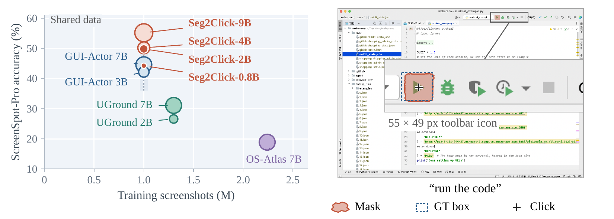
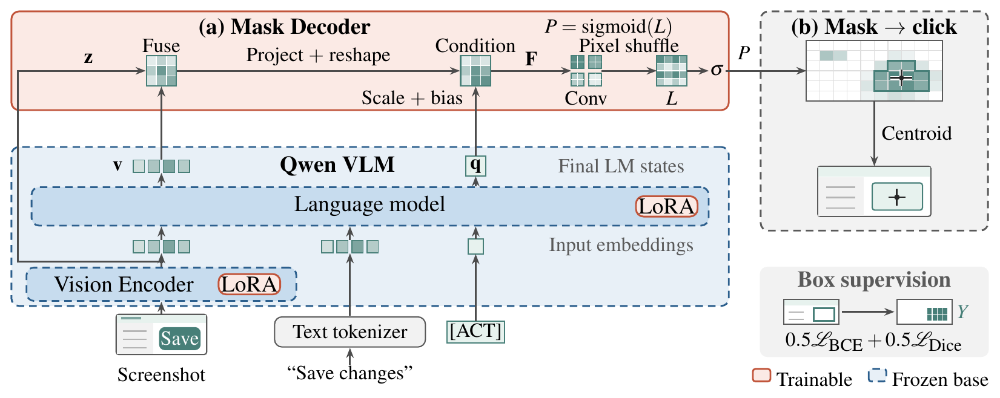

# Seg2Click: Learning Pixel-Level Action Masks for GUI Visual Grounding

<p align="center">
   <a href="https://arxiv.org/abs/2610.16234">Paper</a> &nbsp;|&nbsp;
   <a href="#model-zoo">Models</a> &nbsp;|&nbsp;
   <a href="#data-preparation">Data</a>
</p>

<p align="center">
  
</p>

**Left:** ScreenSpot-Pro accuracy versus number of training screenshots; marker area denotes backbone size. Seg2Click and GUI-Actor share the same ~1M-screenshot grounding data.
**Right:** Qwen3.5-4B predicts the action mask and click for "run the code" (a 55×49 px toolbar icon).

##  Highlights

- **Problem.** Coordinate generation with single-point supervision reduces a spatially extended target to one
  position, even though many click locations are valid. Region-based patch scoring relaxes this, but its spatial
  decisions remain tied to visual-token footprints that may span the target, neighboring controls and background.
- **Executable-region prediction.** Seg2Click reformulates GUI grounding as predicting *where a click can validly
  execute the instruction*. It learns a box-supervised **action mask** and computes the click with a
  deterministic rule.
- **Sub-token action fields.** A query-conditioned pixel-shuffle decoder learns distinct scores *within* each
  visual-token footprint. This yields masks at the processed-screenshot resolution and makes Seg2Click well suited
  to small, densely arranged controls.
- **Simple inference.** One mask-producing forward pass per input. No verifier, zoom-in pass, contour labels or
  coordinate-token generation.
- **Strong results.** Seg2Click-9B reaches **92.1 / 94.1 / 55.2** on ScreenSpot / ScreenSpot-v2 / ScreenSpot-Pro.
  On matched backbones it outperforms both coordinate generation and patch-based grounding (GUI-Actor).

##  Method

<p align="center">
  
</p>

1. **Query-conditioned visual features.** At each visual-token location, the post-merge vision feature
   **z** and the final language-model state **v** are fused residually: **f** = **v** + MLP([**v**; φ(**z**)]).
   The final hidden state of an appended action placeholder `[ACT]` serves as the action query **q**. It modulates
   the fused grid with a learned scale and bias, as in FiLM.
2. **Sub-token mask prediction.** Two 3×3 convolutional blocks and an output projection produce s² logits per
   grid cell. Pixel shuffle rearranges them into a dense field L at the processed-image resolution
   (s = 32 for Qwen3.5, 28 for Qwen2.5-VL).
3. **Box-supervised learning.** Target boxes are rasterized into binary masks. Training uses
   `0.5·BCE + 0.5·Dice`, with LoRA on the backbone and an FP32 mask decoder.
4. **Deterministic click extraction.** Threshold `sigmoid(L)` at 0.5, keep the largest 4-connected component,
   and click its centroid.

##  Main Results

Hit@1 (%): a prediction is correct when its single click lies inside the annotated target box.

| Method | Backbone | ScreenSpot | ScreenSpot-v2 | ScreenSpot-Pro |
|---|---|:---:|:---:|:---:|
| UI-TARS-7B | Qwen2-VL-7B | 89.5 | 91.6 | 35.7 |
| Jedi-7B | Qwen2.5-VL-7B | – | 91.7 | 39.5 |
| GUI-Actor-3B | Qwen2.5-VL-3B | – | 91.0 | 42.2 |
| GUI-Actor-3B + Verifier | Qwen2.5-VL-3B | – | 92.4 | 45.9 |
| GUI-Actor-7B | Qwen2.5-VL-7B | – | 92.1 | 44.6 |
| GUI-Actor-7B + Verifier | Qwen2.5-VL-7B | – | 92.5 | 47.7 |
| **Seg2Click-3B** | Qwen2.5-VL-3B | 89.1 | 91.3 | 47.0 |
| **Seg2Click-0.8B** | Qwen3.5-0.8B | 87.4 | 89.9 | 44.3 |
| **Seg2Click-2B** | Qwen3.5-2B | 89.8 | 91.6 | 49.8 |
| **Seg2Click-4B** | Qwen3.5-4B | 91.6 | 93.1 | 50.2 |
| **Seg2Click-9B** | Qwen3.5-9B | **92.1** | **94.1** | **55.2** |

The paper reports full per-domain and per-target-type breakdowns.

##  Installation

```bash
git clone https://github.com/jcwang0602/Seg2Click.git
cd Seg2Click
conda create -n seg2click python=3.10 -y
conda activate seg2click
# 1. PyTorch matching your CUDA driver (tested: torch 2.13 + CUDA 13.2)
pip install torch torchvision --index-url https://download.pytorch.org/whl/<your-cuda>
# 2. Seg2Click and its dependencies (transformers 5.16.1, peft 0.20.0, ...)
pip install -e .
# 3. Optional: fast Qwen3.5 linear-attention kernels, and FlashAttention-2
#    (required to train Qwen2-VL / Qwen2.5-VL / Qwen3-VL)
pip install -e ".[qwen35-kernels]"
pip install flash-attn --no-build-isolation
```

<a id="data-preparation"></a>

##  Data Preparation

**Training data.** Seg2Click uses the same processed grounding data as
[GUI-Actor](https://huggingface.co/datasets/cckevinn/GUI-Actor-Data): 1,255,208 records from six sources
(UGround, GUI-Env, GUI-Act, AMEX, AndroidControl, Wave-UI). Download it to `data/GUI-Actor-Data/`:

```text
data/GUI-Actor-Data/
├── uground_bbox.json          + Uground/images/
├── guienv_bbox.json           + guienvs/images/
├── guiact_bbox.json           + GUIAct/web_imgs/
├── amex_bbox.json             + screenshots/
├── androidcontrol_bbox.json   + AndroidControl/tfrecord/images/
└── wave_ui_bbox.json          + Wave-UI/images_fixed/
```

The paths are listed in [`data/data_config.yaml`](data/data_config.yaml). Then build the line-indexed
`.jsonl` / `.jsonl.idx` files once. This is a streaming conversion that never overwrites existing files:

```bash
python scripts/prepare_training_data.py               # convert
python scripts/prepare_training_data.py --check-only  # verify an existing copy
```

Box masks are rasterized on the fly at the visual-token grid; no mask files are generated.

**Evaluation data.**

```text
data/eval/
├── ScreenSpot/data/*.parquet          # huggingface.co/datasets/rootsautomation/ScreenSpot
├── ScreenSpot_v2/data/*.parquet       # huggingface.co/datasets/HongxinLi/ScreenSpot_v2
└── ScreenSpot-Pro/                    # huggingface.co/datasets/likaixin/ScreenSpot-Pro
    ├── annotations/*.json
    └── images/
```

**Base models.** Put the Hugging Face snapshots under `checkpoints/`, e.g. `checkpoints/Qwen3.5-0.8B`,
`checkpoints/Qwen3.5-9B`, `checkpoints/Qwen2.5-VL-3B-Instruct`, `checkpoints/Qwen3-VL-2B-Instruct` or
`checkpoints/Qwen2-VL-2B-Instruct`. Scripts run offline by default; to use another
location, set `BASE_MODEL=/path/to/model`.

##  Training

All recipes train for one epoch on one node with 8 GPUs (effective batch 32, LoRA r=16, lr 1e-4, cosine decay):

```bash
bash scripts/train/qwen35_seg2click.sh                 # Seg2Click-0.8B
MODEL_SIZE=2b bash scripts/train/qwen35_seg2click.sh   # 2b | 4b | 9b
MODEL_SIZE=3b bash scripts/train/qwen25vl_seg2click.sh # Qwen2.5-VL-3B (or 7b)
bash scripts/train/qwen3vl_seg2click.sh                # Qwen3-VL-2B-Instruct
bash scripts/train/qwen2vl_seg2click.sh                # Qwen2-VL-2B-Instruct

```

Common overrides: `OUTPUT_DIR`, `BASE_MODEL`, `NUM_GPUS`, `BATCH_SIZE`, `GRAD_ACCUM`, `LR`, `SEED`, and
`RESUME_FROM_CHECKPOINT` (a `checkpoint-*` directory inside `OUTPUT_DIR`). If you change `NUM_GPUS`, adjust
`BATCH_SIZE` / `GRAD_ACCUM` to keep the effective batch at 32. Each script lists its defaults in its header.

##  Evaluation

Each benchmark runs as an independent process. The launcher starts all three in parallel, one GPU each:

```bash
CHECKPOINT=checkpoints/Seg2Click-Qwen3.5-0.8B GPUS=0,1,2 bash scripts/eval/evaluate_seg2click.sh
```

Or evaluate a single benchmark:

```bash
PYTHONPATH=. python eval/evaluate_seg2click.py \
  --checkpoint checkpoints/Seg2Click-Qwen3.5-0.8B \
  --benchmark screenspot_pro --output_dir results/seg2click-0.8b
```

Results are written to `<output_dir>/<benchmark>/metrics.json` (overall and per-category Hit@1) and
`predictions.json`.

### Example usage

```python
from PIL import Image
from seg2click.predictor import Seg2ClickPredictor

predictor = Seg2ClickPredictor.from_pretrained("checkpoints/Seg2Click-Qwen3.5-0.8B")  # cuda:0 if available
image = Image.open("screenshot.png")
pred = predictor.predict(image, "close this window")

x, y = pred.point                     # normalized click on the original screenshot
click_px = (x * image.width, y * image.height)
mask = pred.probability               # [H, W] action-mask probabilities (processed resolution)
print(click_px, pred.decode_reason)   # e.g. (1864.3, 186.4) component_centroid
```

<a id="model-zoo"></a>

##  Model Zoo

| Model | Backbone | ScreenSpot | ScreenSpot-v2 | ScreenSpot-Pro |
|---|---|:---:|:---:|:---:|
| [Seg2Click-0.8B](https://huggingface.co/jcwang0602/Seg2Click-Qwen3.5-0.8B) | Qwen3.5-0.8B | 87.4 | 89.9 | 44.3 |
| [Seg2Click-2B](https://huggingface.co/jcwang0602/Seg2Click-Qwen3.5-2B) | Qwen3.5-2B | 89.8 | 91.6 | 49.8 |
| [Seg2Click-3B](https://huggingface.co/jcwang0602/Seg2Click-Qwen2.5-VL-3B) | Qwen2.5-VL-3B | 89.1 | 91.3 | 47.0 |
| [Seg2Click-4B](https://huggingface.co/jcwang0602/Seg2Click-Qwen3.5-4B) | Qwen3.5-4B | 91.6 | 93.1 | 50.2 |
| [Seg2Click-9B](https://huggingface.co/jcwang0602/Seg2Click-Qwen3.5-9B) | Qwen3.5-9B | 92.1 | 94.1 | 55.2 |

All five checkpoints are publicly available on Hugging Face via the links above. Each checkpoint contains
a merged backbone (`model.safetensors`), config, tokenizer and processor, and the FP32 mask decoder
(`phase1_mask_decoder.json` / `.safetensors`). No separate LoRA adapter is needed.

For example, download the 0.8B checkpoint to the path used by the evaluation scripts:

```bash
hf download jcwang0602/Seg2Click-Qwen3.5-0.8B --local-dir checkpoints/Seg2Click-Qwen3.5-0.8B
```

Then use `Seg2ClickPredictor.from_pretrained("checkpoints/Seg2Click-Qwen3.5-0.8B")` as shown above.
Model licenses are documented in each Hugging Face repository; they are separate from the source-code license.

##  Repository Structure

```text
seg2click/
├── predictor.py          # checkpoint loading + inference API
├── pixel_shuffle.py      # query-conditioned pixel-shuffle mask decoder
├── fusion.py             # residual vision / LM feature fusion (Qwen3.5, Qwen3-VL)
├── mask_model.py         # Qwen3.5 training wrapper, BCE + Dice loss
├── qwen_vl_model.py, qwen_vl_decoder.py, checkpointing.py   # Qwen2-VL / Qwen2.5-VL
├── mask_utils.py         # box-mask rasterization and loss helpers
├── dataset.py, runtime.py, constants.py                     # data pipeline
training/                 # one training entry per backbone family
eval/                     # ScreenSpot / ScreenSpot-v2 / ScreenSpot-Pro evaluation
scripts/train, scripts/eval
```

##  Acknowledgements

This codebase builds on [GUI-Actor](https://github.com/microsoft/GUI-Actor), whose processed training data and
data pipeline we reuse. We also thank the authors of
[Qwen-VL](https://github.com/QwenLM), [Transformers](https://github.com/huggingface/transformers),
[PEFT](https://github.com/huggingface/peft) and the ScreenSpot, ScreenSpot-v2 and ScreenSpot-Pro benchmarks.

##  Citation

```bibtex
@article{seg2click2026,
  title   = {Seg2Click: Learning Pixel-Level Action Masks for GUI Visual Grounding},
  author  = {Wang, Jingchao and Huang, Dingjiang},
  journal = {arXiv preprint arXiv:2610.16234},
  year    = {2026},
  doi     = {10.48550/arXiv.2610.16234},
  url     = {https://arxiv.org/abs/2610.16234}
}
```

##  License

MIT. See [LICENSE](LICENSE).
